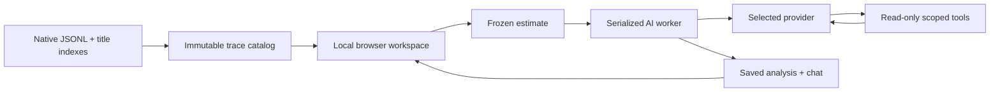

# Build and development

C17 server, local browser UI. No frontend build step. Run commands here (`cd src`).

## Build

Install CMake 3.25+, pkg-config, a C compiler, libcurl, and libuv development packages.

```sh
# macOS
brew install cmake pkg-config libuv
# Ubuntu
sudo apt-get install build-essential cmake pkg-config libcurl4-openssl-dev libuv1-dev

sh scripts/install-tiktoken.sh .deps
cmake -S . -B build -DCMAKE_BUILD_TYPE=Release
cmake --build build --parallel 4
cp env.template .env
./build/symbiosic
```

Open `http://127.0.0.1:4317`. Stop with Ctrl-C. Intel macOS also needs Rust/Cargo to compile the pinned tokenizer source.

Alternatively, with yyjson and llhttp installed: `make deps && make && ./symbiosic`.

Windows builds use the MSYS2 **MSYS** shell:

```sh
pacman -S --needed gcc make cmake pkgconf libcurl-devel libzstd-devel libuv-devel python unzip binutils \
  mingw-w64-x86_64-gcc mingw-w64-x86_64-binutils
sh scripts/install-tiktoken.sh .deps
cmake -S . -B build -G 'Unix Makefiles' -DCMAKE_BUILD_TYPE=Release
cmake --build build --parallel 4
cp .deps/tiktoken_c.dll build/
./build/symbiosic.exe
```

## Configuration

Environment variables override `.env`. UI keys stay in memory; model defaults persist in `DATA_DIR/ai-settings.json`.

| Variable | Default |
| --- | --- |
| `CLAUDE_ROOT` | `~/.claude/projects` |
| `CODEX_ROOT` | `~/.codex/sessions` |
| `DATA_DIR` | `./data` |
| `PORT` | `4317` |
| `POLL_MS` | `2000` |
| `OPENAI_API_KEY`, `ANTHROPIC_API_KEY`, `OPENROUTER_API_KEY`, `GEMINI_API_KEY` | Empty |

Desktop packages store data in `~/Library/Application Support/Symbiosic` (macOS), `$XDG_DATA_HOME/symbiosic` or `~/.local/share/symbiosic` (Linux), and `%LOCALAPPDATA%/Symbiosic` (Windows). Launchers open the browser after startup; quitting stops the server.

Keyless demo:

```sh
OPENAI_API_KEY= DATA_DIR=./data/demo \
  CLAUDE_ROOT=./tests/demo/claude CODEX_ROOT=./tests/demo/codex ./build/symbiosic
```

## Tests

```sh
ctest --test-dir build --output-on-failure
cp build/symbiosic symbiosic  # Windows: copy the .exe and tokenizer DLL
python3 tests/http_test.py
npm ci
npx playwright install chromium
npm test
# With all Makefile dependencies installed:
make sanitize
```

C checks cover normalization, provider replay, retrieval, budgets, persistence, and queued work. HTTP checks cover title indexes, restart, assets, origins, and filesystem access. Browser checks cover previews, nested model selection, inline estimates, and widths from 320–1440px. Tests use fixtures and fake provider responses; no paid requests.

## Packages

```sh
python3 scripts/package.py macos-arm64
# Other native hosts: macos-x86_64, linux-x86_64, windows-x86_64
```

Outputs and SHA-256 files go to `dist/`. Build on each target architecture. macOS uses an `.app` inside a DMG; Linux uses a portable archive with a desktop installer; Windows uses a portable executable and bundled runtime DLLs. macOS packages use ad-hoc signatures; Apple signing/notarization requires developer credentials.

[Release workflow](../.github/workflows/release.yml) builds and tests all four targets. Push a `v*` tag to publish only after every target passes. `workflow_dispatch` builds downloadable CI artifacts without publishing.

## Design



Native names outrank prompt fallbacks. Title edits preserve evidence revisions. Provider-native messages retain signed thinking, tool IDs, and opaque metadata through tool rounds. File and message previews render in the workspace; Settings is the only dialog.

## Dependencies

CMake verifies pinned yyjson 0.13.0 and llhttp 9.4.3 archives. The tokenizer installer verifies tiktoken-c v0.9.1; Intel macOS compiles that source. libcurl and libuv come from the host package manager. Runtime licenses ship in each package.

- [yyjson (MIT)](https://github.com/ibireme/yyjson/tree/0.13.0)
- [llhttp (MIT)](https://github.com/nodejs/llhttp/tree/release/v9.4.3)
- [tiktoken-c (MIT)](https://github.com/kojix2/tiktoken-c/tree/v0.9.1)
- [libcurl](https://curl.se/docs/copyright.html), [libuv (MIT)](https://github.com/libuv/libuv/blob/v1.x/LICENSE)
- [MSYS2 runtime and package sources](https://packages.msys2.org/)

Provider replay follows [Anthropic thinking](https://platform.claude.com/docs/en/build-with-claude/extended-thinking), [OpenRouter reasoning](https://openrouter.ai/docs/guides/best-practices/reasoning-tokens), and [Gemini compatibility](https://ai.google.dev/gemini-api/docs/openai). The tokenizer estimates non-OpenAI usage heuristically. No automatic secret redaction is implemented.
