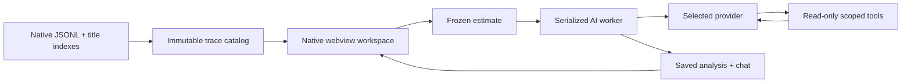

# Build and development

C17 server with a lightweight native webview window. No frontend build step. Run commands here (`cd src`).

## Build

Install CMake 3.25+, pkg-config, C and C++ compilers, libcurl, and libuv development packages. The backend remains C17; the small webview library compiles as C++.

```sh
# macOS
brew install cmake pkg-config libuv
# Ubuntu
sudo apt-get install build-essential cmake pkg-config libcurl4-openssl-dev libuv1-dev libgtk-3-dev libwebkit2gtk-4.1-dev

sh scripts/install-tiktoken.sh .deps
cmake -S . -B build -DCMAKE_BUILD_TYPE=Release
cmake --build build --parallel 4
cp env.template .env
./build/symbiosic
```

The workspace opens in a resizable native window using WebKit on macOS or WebKitGTK on Linux. Closing the window or quitting the app stops the listener, marks queued work interrupted, waits for active workers, releases the data lock, and exits. Active network calls can take up to 120 seconds to finish. Intel macOS also needs Rust/Cargo to compile the pinned tokenizer source.

For browser development or a display-free environment, run `./build/symbiosic --headless`, then open the printed URL; stop with Ctrl-C. To omit the webview build dependency entirely, configure with `-DSYMBIOSIC_DESKTOP=OFF`.

Alternatively: `make deps && make && ./symbiosic`. `make` uses CMake for the desktop executable; `make DESKTOP=OFF` builds only the server. The direct Makefile C tests additionally need system yyjson and llhttp.

Windows builds use the MSYS2 **MSYS** shell. Tests need native symlinks (`MSYS=winsymlinks:nativestrict`) and Windows Developer Mode or administrator rights:

```sh
pacman -S --needed gcc make cmake pkgconf ca-certificates libcurl-devel libzstd-devel libuv-devel python unzip binutils \
  mingw-w64-x86_64-gcc mingw-w64-x86_64-binutils mingw-w64-x86_64-cmake mingw-w64-x86_64-make
sh scripts/install-tiktoken.sh .deps
cmake -S . -B build -G 'Unix Makefiles' -DCMAKE_BUILD_TYPE=Release
cmake --build build --parallel 4
cp .deps/tiktoken_c.dll build/
./build/symbiosic.exe --headless
python scripts/package.py windows-x86_64
```

On Windows the POSIX backend runs under the bundled MSYS runtime. Packaging builds a tiny native MinGW WebView2 host (`Symbiosic.exe`) with no console window. It starts the backend, waits for its bound URL, and opens the embedded window. Closing the host's stdin pipe requests graceful backend shutdown; an unexpected host exit also closes that pipe. Install Microsoft Edge WebView2 Runtime if it is missing. The WebView2 profile and backend log live in `%LOCALAPPDATA%/Symbiosic`.

## Configuration

Environment variables override `.env`. UI keys stay in memory; model defaults persist in `DATA_DIR/ai-settings.json`.

The saved directory/session catalog loads at startup while discovery checks for updates. Folder browsing lists only the selected folder's metadata and runs independently of AI work. File counts, sizes, and language totals in the browser describe that folder; an explicit analysis estimate builds the full recursive workspace manifest.

| Variable | Default |
| --- | --- |
| `CLAUDE_ROOT` | `~/.claude/projects` |
| `CODEX_ROOT` | `~/.codex/sessions` |
| `DATA_DIR` | `./data` |
| `PORT` | Automatic free port for desktop; `4317` for headless. `0` always selects a free port. |
| `POLL_MS` | `2000` |
| `OPENAI_API_KEY`, `ANTHROPIC_API_KEY`, `OPENROUTER_API_KEY`, `GEMINI_API_KEY` | Empty |

Desktop packages store data in `~/Library/Application Support/Symbiosic` (macOS), `$XDG_DATA_HOME/symbiosic` or `~/.local/share/symbiosic` (Linux), and `%LOCALAPPDATA%/Symbiosic` (Windows). An explicit `PORT` in the environment or `.env` takes precedence. The listener binds only `127.0.0.1`; origin checks use its actual bound port.

Keyless demo:

```sh
OPENAI_API_KEY= DATA_DIR=./data/demo \
  CLAUDE_ROOT=./tests/demo/claude CODEX_ROOT=./tests/demo/codex ./build/symbiosic
```

## Tests

```sh
ctest --test-dir build --output-on-failure
cp build/symbiosic symbiosic  # Windows: copy the .exe and tokenizer DLL
python3 tests/http_test.py
# With a desktop session (Linux CI: xvfb-run -a ...):
python3 tests/desktop_test.py build/symbiosic
npm ci
npx playwright install chromium
npm test
# With all Makefile dependencies installed:
make sanitize
```

C checks cover normalization, provider replay, retrieval, budgets, persistence, and queued work. HTTP checks cover title indexes, restart, assets, origins, and filesystem access. Browser checks cover previews, nested model selection, inline estimates, and widths from 320–1440px. Tests use fixtures and fake provider responses; no paid requests.

## Packages

```sh
python3 scripts/package.py macos-arm64
# Other native hosts: macos-x86_64, linux-x86_64, windows-x86_64
```

Test the Windows ZIP from native PowerShell Python, outside MSYS. This checks the bundled runtime independently.

Outputs and SHA-256 files go to `dist/`. Build on each target architecture. macOS uses an `.app` inside a DMG; Linux uses a portable archive with a desktop installer; Windows uses a portable executable and bundled runtime DLLs. macOS packages use ad-hoc signatures; Apple signing/notarization requires developer credentials.

[Release workflow](../.github/workflows/release.yml) builds and tests all four targets. Push a `v*` tag to publish only after every target passes. `workflow_dispatch` builds downloadable CI artifacts without publishing.

## Design



Native names outrank prompt fallbacks. Title edits preserve evidence revisions. Provider-native messages retain signed thinking, tool IDs, and opaque metadata through tool rounds. File and message previews render in the workspace; Settings is the only dialog.

## Dependencies

CMake verifies pinned yyjson 0.13.0, llhttp 9.4.3, and webview 0.12.0 archives. The tokenizer installer verifies tiktoken-c v0.9.1; Intel macOS compiles that source. libcurl and libuv come from the host package manager. The system supplies WebKit, WebKitGTK, or WebView2; no browser engine is bundled. Runtime licenses ship in each package.

- [yyjson (MIT)](https://github.com/ibireme/yyjson/tree/0.13.0)
- [llhttp (MIT)](https://github.com/nodejs/llhttp/tree/release/v9.4.3)
- [tiktoken-c (MIT)](https://github.com/kojix2/tiktoken-c/tree/v0.9.1)
- [webview (MIT)](https://github.com/webview/webview/tree/0.12.0)
- [libcurl](https://curl.se/docs/copyright.html), [libuv (MIT)](https://github.com/libuv/libuv/blob/v1.x/LICENSE)
- [MSYS2 runtime and package sources](https://packages.msys2.org/)

OpenAI requests include [encrypted reasoning state](https://developers.openai.com/cookbook/examples/responses_api/reasoning_items) for stateless tool continuations. Provider replay follows [Anthropic thinking](https://platform.claude.com/docs/en/build-with-claude/extended-thinking), [OpenRouter reasoning](https://openrouter.ai/docs/guides/best-practices/reasoning-tokens), and [Gemini compatibility](https://ai.google.dev/gemini-api/docs/openai). The tokenizer estimates non-OpenAI usage heuristically. No automatic secret redaction is implemented.
